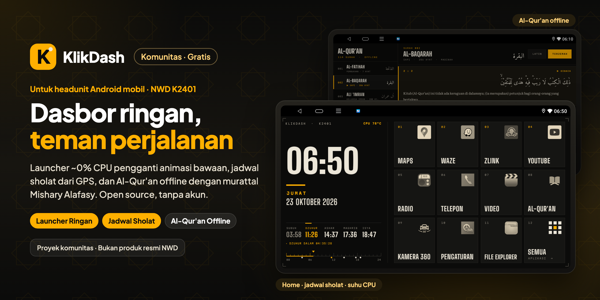

<p align="center">
  
</p>

<p align="center">
  Launcher ringan, gratis, dan open source untuk headunit Android mobil NWD K2401 (Allwinner, Android 10, 1280×720): home bergaya panel instrumen pengganti animasi 3D bawaan, jadwal sholat dari GPS dengan hitung mundur, suhu CPU, ubin aplikasi yang bisa disusun, dan Al-Qur'an offline dengan murattal Mishary Alafasy. Sepenuhnya offline, tanpa akun.
</p>

<p align="center">
  ⚠️ <b>Tidak resmi.</b> KlikDash adalah launcher buatan komunitas. Tidak dibuat, didukung, maupun disahkan oleh NWD atau produsen headunit.
</p>

<p align="center">
  <a href="https://github.com/ashafizullah/klikdash/releases/latest"></a>
  <a href="https://github.com/ashafizullah/klikdash/releases"></a>
  <a href="LICENSE"></a>
  
  
  <br>
  
  
  
</p>

<p align="center">
  <a href="https://trakteer.id/adamshafizullah/tip"></a>
</p>

<p align="center">
  Bagian dari <a href="https://klikapps.pages.dev"><b>Klik Apps</b></a>, kumpulan aplikasi gratis dan open source: <a href="https://klikapps.pages.dev">klikapps.pages.dev</a>
</p>

<p align="center">
  <a href="README.md">English</a> | <b>Bahasa Indonesia</b><br>
  <sub>Proyek komunitas, tidak berafiliasi dengan NWD.</sub>
</p>

## Tentang

Launcher ringan untuk headunit Android mobil **K2401** (Allwinner sun50iw10, Android 10, layar 1280×720).
Menggantikan launcher bawaan NWD yang terus merender animasi 3D (~40% CPU) dengan home statis bergaya
panel instrumen (~0–1% CPU, ~30 MB RAM). Ditulis dengan Java murni tanpa library, dan di-build tanpa Gradle.


## Fitur

**Home**
- Jam besar, hari dan tanggal dalam bahasa Indonesia, serta penggaris 24 jam dengan penanda waktu sholat.
- Jadwal sholat offline metode Kemenag (Subuh 20°, Isya 18°, Ashar Syafi'i, ihtiyath +2 menit).
  Lokasi diambil otomatis dari GPS dengan menumpang *passive provider*, sehingga tidak ada beban tambahan.
  Hitung mundur ke waktu sholat berikutnya diperbarui per detik.
- Suhu CPU headunit, diperbarui tiap 5 detik. Warnanya abu-abu di bawah 70 °C, amber mulai 70 °C,
  dan merah dengan tulisan "PANAS" mulai 85 °C.
- Grid 4×3 berisi 11 ubin aplikasi dan ubin **Semua aplikasi**.
  - **Ketuk:** buka aplikasi.
  - **Tekan lama lalu geser** ke ubin lain: tukar posisi.
  - **Tekan lama lalu lepas di tempat:** pilih aplikasi lain untuk ubin itu.
- Di daftar Semua aplikasi, tekan lama sebuah aplikasi untuk membuka App Info.

**Al-Qur'an (offline)**
- 114 surah dengan teks Arab mushaf standar Kemenag, terjemahan Kemenag, dan Latin yang bisa dinyalakan
  atau dimatikan.
- Murattal **Mishary Rashid Alafasy** per ayat. Ayat yang sedang dibaca disorot dan layar ikut scroll
  otomatis.
- Mode putar: Lanjut (terus ke surah berikutnya), Ulang surah, atau Ulang ayat. Posisi terakhir disimpan.
- Audio tetap jalan di latar (foreground service + MediaSession), sehingga bisa dikendalikan dari
  notifikasi dan tombol media atau setir.
- Tidak ada yang ikut di APK: teks diunduh sekali di dalam aplikasi (sekitar 6 MB, dari equran.id), dan audio
  diunduh per ayat saat diputar, sementara sisa surahnya diunduh di latar. Tombol **UNDUH** menyimpan satu
  surah utuh sebelum perjalanan; surah yang sudah tersimpan ditandai **OFFLINE**.

**Penyetelan otomatis saat menyala** (lihat [Cara kerja khusus firmware](#cara-kerja-khusus-firmware))
- ksmd dimatikan setiap boot.
- Kalau Zlink (CarPlay/AA nirkabel) membuka tampilannya sendiri dalam 3 menit pertama setelah boot atau
  bangun dari tidur, layar dikembalikan ke home. Sesi CarPlay tetap berjalan di latar.

## Perangkat yang didukung

KlikDash butuh **Android 10 atau lebih baru** dan tata letaknya dibuat untuk layar **1280×720 landscape**.
Bagian yang khusus headunit (launcher default, tidur/bangun, Zlink, ksmd) ditujukan untuk firmware NWD.

| Perangkat | Layar | Android | Status |
|---|---|---|---|
| NWD K2401 (Allwinner sun50iw10) | 1280×720 | 10 | ✅ diuji di perangkat asli |
| Headunit lain dengan firmware NWD | 1280×720 | 10+ | ⚠️ seharusnya jalan, belum diuji |
| Headunit Android lain (FYT, MTK, Rockchip, …) | 1280×720 | 10+ | ⚠️ launcher, jadwal sholat, dan Al-Qur'an seharusnya jalan; penyetelan khusus NWD tidak berlaku |
| Ukuran layar lain atau layar portrait | – | 10+ | ❌ belum dibuatkan tata letaknya |

Zlink dipakai dengan CarPlay nirkabel di iPhone; Android Auto belum diuji. Laporan dari headunit lain sangat membantu:
buka issue dengan menyebut model, ukuran layar, dan versi Android.

## Pemasangan

👉 **[Panduan pasang langkah demi langkah](docs/INSTALL.id.md)** (untuk pemula, dengan screenshot dan tanya jawab)

1. Unduh `klikdash-<versi>.apk` dari [Releases](https://github.com/ashafizullah/klikdash/releases/latest).
2. Pasang: salin ke flashdisk lalu buka dengan file manager headunit, atau jalankan
   `adb install klikdash-<versi>.apk`.
3. Jadikan home: buka KlikDash lalu ketuk tombol kuning **JADIKAN TAMPILAN UTAMA**. Di firmware NWD,
   tombol ini mengatur launcher sendiri (butuh USB debugging aktif); di headunit lain, tombol ini membuka
   pengaturan *Aplikasi home default*. Tombol **LAUNCHER BAWAAN** di halaman Semua aplikasi mengembalikannya.
   Cara manual lewat ADB:
   ```bash
   adb shell setprop persist.nwd.launcher.default com.klikdash.app
   adb shell cmd package set-home-activity com.klikdash.app/.HomeActivity
   ```
4. Izinkan akses lokasi saat diminta (untuk jadwal sholat).
5. Saat ada internet, buka **Al-Qur'an** sekali dan ketuk **UNDUH TEKS** untuk mengunduh teksnya.
6. Jalankan [daftar uji sebelum berkendara](#disclaimer) dalam keadaan mobil diam.

## Struktur

```
klikdash/
├── AndroidManifest.xml
├── build.sh                  build + pasang ke headunit
├── klikdash.keystore         kunci tanda tangan APK (jangan hilang, lihat Catatan)
├── src/com/klikdash/app/
│   ├── HomeActivity.java     launcher: ubin, jam, sholat, suhu, drag & drop
│   ├── PrayerTimes.java      perhitungan jadwal sholat (algoritma praytimes.org)
│   ├── QuranActivity.java    tampilan mushaf + pemutar
│   ├── QuranService.java     pemutar murattal di latar
│   ├── QuranData.java        pemuat assets/quran.txt
│   └── Tweaks.java           perintah sistem lewat ADB lokal (ksmd, sembunyikan Zlink)
├── res/                      tema, ikon vektor
├── assets/
│   ├── quran.txt             6.236 ayat (Arab, Latin, terjemahan), 3,1 MB — TIDAK ada di repo, dibangun sendiri
│   ├── display.ttf           Big Shoulders (jam, label)
│   ├── mono.ttf              Martian Mono (angka kecil)
│   ├── arabic.ttf            Amiri Quran
│   ├── serif.ttf             Literata (terjemahan; di-instance & subset)
│   └── licenses/             teks SIL OFL tiap font (ikut terbawa di APK)
├── tools/build_quran.py      bangun quran.txt dari JSON equran.id
├── design/                   header README (header.html → header.png / header.id.png) + screenshot asli
└── LICENSE                   MIT (kode); font tetap OFL

../quran-data/                tidak ikut APK
├── text/                     JSON per surah dari equran.id
├── zips/  audio/             murattal Alafasy 128 kbps (everyayah.com), 6.236 file mp3
└── intro/                    file SSS000.mp3 (tidak dipakai)
```

## Kebutuhan

- macOS dengan JDK 17 dan Android SDK (`build-tools/36.0.0`, `platforms/android-35`)
  di `~/Library/Android/sdk` atau `$ANDROID_HOME`.
- `adb`. Headunit dihubungkan lewat **ADB WiFi** (`192.168.1.17:5555`), karena port USB headunit
  berperan sebagai host.

## Build & pasang

Pertama kali, bangun dulu `assets/quran.txt` (lihat [Teks Al-Qur'an](#teks-al-quran)); `build.sh` berhenti
dengan petunjuk bila file itu belum ada.

```bash
adb connect 192.168.1.17:5555
./build.sh              # build saja → build/klikdash.apk
./build.sh release      # APK rilis publik tanpa teks Al-Qur'an → build/klikdash-<versi>.apk
./build.sh install      # build, pasang, beri izin lokasi, jadikan home
DEVICE=1.2.3.4:5555 ./build.sh install   # kalau IP headunit berubah
```

Selalu pasang lewat `./build.sh install`. Kalau memakai `adb install` biasa, preferensi home bisa hilang
sampai `set-home-activity` dijalankan ulang.

## Audio murattal

Aplikasi mengunduh audionya sendiri (lihat Fitur). Untuk mengisi ke-114 surah sekaligus (1,6 GB) tanpa
memakai koneksi headunit, unduh di komputer lalu kirim lewat ADB. Lokasi filenya:
`/sdcard/Android/data/com.klikdash.app/files/quran/audio/SSSAAA.mp3`.

```bash
# unduh (sekali)
cd ../quran-data
seq -f "%03g" 1 114 | xargs -P 4 -I{} curl -fsS -C - -o zips/{}.zip \
  https://everyayah.com/data/Alafasy_128kbps/zips/{}.zip
for z in zips/*.zip; do unzip -qq -o -j "$z" '*.mp3' -d audio; done
mkdir -p intro && mv audio/*000.mp3 intro/

# kirim ke headunit (~20 menit lewat WiFi)
adb push audio /sdcard/Android/data/com.klikdash.app/files/quran/
```

Basmalah sebelum ayat 1 (kecuali Al-Fatihah dan At-Taubah) memakai `001001.mp3`.

> ⚠️ Folder itu milik aplikasi. **Uninstall KlikDash akan menghapus audionya.** Update lewat
> `./build.sh install` aman.

## Teks Al-Qur'an

Teks mushaf dan terjemahan Kemenag **tidak disertakan di repo ini maupun di APK rilis**. Peredaran mushaf di
Indonesia diatur PMA 44/2016 (pentashihan LPMQ). Aplikasi mengunduh teksnya dari equran.id saat pertama
dipakai dan membersihkannya dengan cara yang sama seperti `tools/build_quran.py` (hasilnya identik byte per
byte), yaitu menyesuaikan beberapa tanda agar bisa ditampilkan font Amiri. Untuk build pengembang sendiri,
teksnya bisa disertakan (`./build.sh` menyertakan `assets/quran.txt` bila ada; `./build.sh release` tidak pernah):

```bash
mkdir -p ../quran-data/text
for i in $(seq 1 114); do curl -fsS -o ../quran-data/text/$i.json https://equran.id/api/v2/surat/$i; done
python3 -I tools/build_quran.py ../quran-data/text assets/quran.txt
```

Skrip ini juga membersihkan teks:
- Menghapus penanda khas mushaf Kemenag yang tidak ada di font Amiri dan tidak dibaca:
  U+08D6 (tanda ruku'), U+06D4 (pemisah juz), dan U+06D5 (tumpuan waqaf).
- Menempelkan tanda waqaf ke kata sebelumnya.
- Membuang karakter kontrol.

## Perubahan pada headunit

| Perubahan | Cara mengembalikan |
|---|---|
| Launcher default `persist.nwd.launcher.default=com.klikdash.app` | `adb shell setprop persist.nwd.launcher.default com.android.launcher` |
| Preferensi HOME ke KlikDash | `adb shell cmd package set-home-activity com.android.launcher/com.android.launcher2.Launcher` |
| TikTok di-uninstall | Pasang ulang dari Play Store |
| YouTube dilarang jalan di latar | `adb shell cmd appops set com.google.android.youtube RUN_ANY_IN_BACKGROUND allow` (juga `RUN_IN_BACKGROUND`) |
| ksmd mati (oleh KlikDash, setiap boot) | Hapus `Tweaks.applyAsync()` di `HomeActivity`, lalu reboot |

Launcher NWD lama **tidak dihapus**. Prosesnya tetap ada karena juga menangani info mobil dari CAN.

## Cara kerja khusus firmware

- **Launcher default.** Firmware NWD mengabaikan pilihan home Android dan memakai
  `persist.nwd.launcher.default` (`PackageManagerService.chooseBestActivity`).
- **Direct boot.** Saat boot, penyimpanan terenkripsi (FBE) masih terkunci beberapa detik, dan hanya
  launcher yang `directBootAware` yang bisa dipilih. Karena itu `HomeActivity` dibuat directBootAware dan
  pengaturannya disimpan di penyimpanan DE. Daftar aplikasi dimuat ulang setelah `ACTION_USER_UNLOCKED`.
- **Perintah sistem.** Mematikan ksmd dan kembali ke home butuh hak sistem. `Tweaks.java` menjalankannya
  lewat ADB perangkat itu sendiri (`127.0.0.1`), tanpa mengubah partisi sistem, sehingga ADB harus aktif di
  headunit. Kalau ADB mati, kedua penyetelan ini dilewati, sedangkan fitur lain tetap jalan.
- **Headunit tidur, bukan mati.** Saat ACC off headunit hanya tidur, jadi jendela "baru menyala" untuk
  Zlink juga dimulai dari `SCREEN_ON`, `com.nwd.ACTION_AUTO_SLEEP_WAKE_STATE`, dan
  `com.nwd.android.ACTION_SYSTEM_AUTO_WAKEUP`.
- **Zlink dan WiFi.** Saat menyala, layanan Zlink menyalakan hotspot untuk CarPlay nirkabel, dan chip WiFi
  tidak bisa menjalankan hotspot dan WiFi klien bersamaan. Selama CarPlay nirkabel aktif, **WiFi akan
  mati** dan headunit tidak bisa diakses dari Mac. Untuk mengakses ADB, nyalakan WiFi secara manual.

## Catatan & keterbatasan

- **Keamanan.** ADB WiFi yang aktif memberi akses penuh ke headunit. Hanya sambungkan headunit ke jaringan
  pribadi (misalnya hotspot HP sendiri), jangan ke WiFi publik.
- **Nama kota tidak terdeteksi otomatis**, karena geocoder di perangkat ini tidak mengembalikan hasil.
  Nama kota bisa diisi manual dan tetap dipakai selama posisi masih dalam radius 15 km:
  ```bash
  adb shell am start -n com.klikdash.app/.HomeActivity --es lat -6.1754 --es lon 106.8272 --es city "Jakarta"
  ```
- **Akurasi jadwal sholat** ±1 menit dibanding jadwal Kemenag (sudah dibandingkan untuk Jakarta,
  26 Oktober 2026).
- **`klikdash.keystore`** (alias `kokpit`) wajib dicadangkan di tempat aman, misalnya lampiran password
  manager. File ini tidak ikut di repo. Password-nya ada di **macOS Keychain** (servis `klikdash-keystore`):
  `security find-generic-password -a klikdash -s klikdash-keystore -w`. Untuk CI, isi env `KLIKDASH_KS_PASS`.
  APK yang ditandatangani kunci lain tidak bisa meng-update KlikDash; harus uninstall dulu, dan uninstall
  ikut menghapus audio murattal. Clone baru tanpa keystore akan dibuatkan kunci baru oleh `build.sh`.

## Disclaimer

**Gunakan dengan risiko sendiri.** Perangkat lunak ini diberikan "apa adanya", tanpa jaminan apa pun
(lihat [LICENSE](LICENSE)).

> ⚠️ **Uji dulu sebelum berkendara.** Setelah memasang KlikDash, dalam keadaan mobil diam, pastikan semua ini masih berfungsi:
> - **Kamera mundur:** masuk gigi R, gambar kamera harus langsung muncul.
> - **Kamera 360** (jika ada).
> - **Peringatan pintu terbuka dan info mobil** dari CAN.
> - **Tombol setir:** volume, lagu berikutnya, dan telepon.
> - **Radio, Bluetooth, dan telepon.**
>
> Kalau ada yang tidak jalan, **kembalikan ke launcher bawaan** (lihat
> [Perubahan pada headunit](#perubahan-pada-headunit)) dan laporkan lewat issue. Jangan berkendara dengan kamera
> mundur yang tidak berfungsi. Sebagian firmware menampilkan kamera mundur atau peringatan pintu lewat launcher
> bawaan, jadi hasilnya bisa berbeda di tiap headunit.

- Mengganti launcher default dan pengaturan sistem tidak didukung produsen headunit dan bisa berpengaruh
  pada garansi. Semua perubahan bisa dikembalikan (lihat [Perubahan pada headunit](#perubahan-pada-headunit)).
- **Jangan mengoperasikan layar sambil menyetir.** Pakai tombol setir, atau berhenti dengan aman dulu.
- Jadwal sholat adalah hasil hitungan dan bisa selisih sekitar satu menit dari jadwal resmi; ikuti masjid
  atau otoritas setempat.
- Teks Al-Qur'an dan terjemahannya tidak disertakan; periksa teks yang Anda bangun terhadap mushaf resmi.
- KlikDash adalah proyek komunitas dan tidak berafiliasi dengan maupun didukung oleh NWD.

## Header README

`design/header.png` (EN) dan `design/header.id.png` (ID) dirender dari `design/header.html` memakai
screenshot asli headunit:

```bash
cd design
for l in en id; do
  out=header.png; [ $l = id ] && out=header.id.png
  "/Applications/Google Chrome.app/Contents/MacOS/Google Chrome" --headless=new --hide-scrollbars \
    --window-size=1280,640 --force-device-scale-factor=2 --virtual-time-budget=5000 \
    --screenshot="$PWD/$out" "file://$PWD/header.html?lang=$l"
done
```

## Sumber & lisensi

- **Kode:** [MIT](LICENSE).
- **Font:** [SIL Open Font License 1.1](assets/licenses/), yaitu Big Shoulders, Martian Mono, Amiri Quran,
  dan Literata (via Google Fonts). Literata di-instance dan di-subset; nama dan lisensinya tetap.
- **Teks, transliterasi, dan terjemahan** (tidak disertakan): [equran.id](https://equran.id), yaitu mushaf
  standar dan terjemahan Kemenag RI. Hak dan ketentuannya ada pada pemiliknya.
- **Audio** (tidak disertakan): [everyayah.com](https://everyayah.com) / versebyversequran.com, Mishary
  Rashid Alafasy 128 kbps. Ikuti lisensi di situs tersebut.
- **Jadwal sholat:** algoritma [praytimes.org](http://praytimes.org).

Proyek ini tidak berafiliasi dengan NWD, Zjinnova (Zlink), Apple, Google, maupun Kemenag RI.
