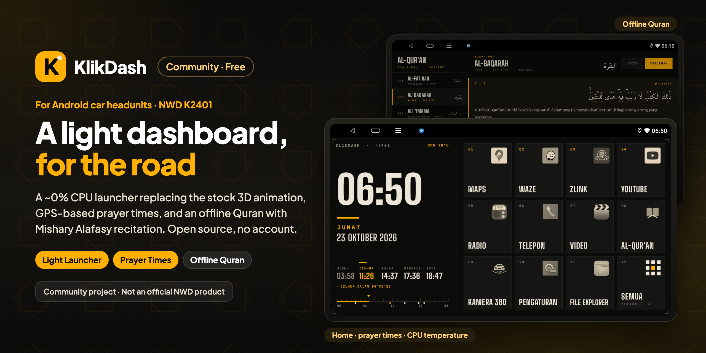

<p align="center">
  
</p>

<p align="center">
  A free, open-source lightweight launcher for the NWD K2401 Android car headunit (Allwinner, Android 10, 1280×720): an instrument-panel home screen that replaces the stock 3D animation, GPS-based prayer times with a live countdown, CPU temperature, rearrangeable app tiles, and an offline Quran with Mishary Alafasy recitation. Fully offline, no account.
</p>

<p align="center">
  ⚠️ <b>Unofficial.</b> KlikDash is a community-made launcher. It is not made, endorsed or supported by NWD or any headunit manufacturer.
</p>

<p align="center">
  <a href="https://github.com/ashafizullah/klikdash/releases/latest"></a>
  <a href="https://github.com/ashafizullah/klikdash/releases"></a>
  <a href="LICENSE"></a>
  
  
  <br>
  
  
  
</p>

<p align="center">
  <a href="https://trakteer.id/adamshafizullah/tip"></a>
</p>

<p align="center">
  Part of <a href="https://klikapps.pages.dev"><b>Klik Apps</b></a>, a collection of free and open-source apps: <a href="https://klikapps.pages.dev">klikapps.pages.dev</a>
</p>

<p align="center">
  <b>English</b> | <a href="README.id.md">Bahasa Indonesia</a><br>
  <sub>Community project, not affiliated with NWD.</sub>
</p>

## Demo

https://github.com/user-attachments/assets/0fcf025c-dae2-4e65-ad56-9a48430e644f

<sub>K2001N, 1024×600: prayer times, GPS speed, BT music, volume popup, and renumbered tiles.</sub>

## Fork: K2001N / Android 7.1.1

> [!IMPORTANT]
> **This is the `android-7` fork, not upstream.** It targets the **NWD K2001N** (1024×600, Android 7.1.1)
> and adds features the upstream K2401 build does not have. Upstream remains Android 10 / 1280×720.

| Area | Upstream (K2401) | This fork (K2001N) |
|---|---|---|
| Device | K2401 · Android 10 · 1280×720 | **K2001N · Android 7.1.1 · 1024×600** |
| Home tiles | 11 app tiles + All apps; drag to swap | **GPS speed card takes the first 2 cells; 9 app tiles + All apps renumbered 01–10** |
| Tile editing | Long-press + drag to swap; release to pick | **Long-press opens `Ganti` / `Hapus`; drag-to-swap removed** |
| GPS speed | — | **Live km/h at 1 Hz, speed-tier colors, vertical 0–150 bar** |
| Bluetooth | — | **BT music widget: album art, title/artist, prev/play/next** |
| Status line | CPU temperature | **CPU temperature + CPU% + RAM** |
| Volume | — | **Headunit MCU volume (system/BT) with on-screen popup** |
| Screen off | — | **Experimental MCU protocol broadcast (not verified yet)** |
| App list | Wallpaper entry visible | **Wallpaper entry hidden** |

Build this branch with `./build.sh` → `build/klikdash.apk`. The Quran, prayer times, and the rest of the core
launcher are unchanged from upstream.

## About

A lightweight launcher for the **K2401** Android car headunit (Allwinner sun50iw10, Android 10, 1280×720
screen). It replaces the stock NWD launcher, which renders a 3D animation nonstop (~40% CPU), with a static
instrument-panel home screen (~0–1% CPU, ~30 MB RAM). Written in plain Java with no libraries and built
without Gradle. The app's own interface is in Indonesian.

> The application ID stays `id.kokpit` (the project's old name). Changing it would make Android treat it as
> a new app, and the data and recitation audio stored in the app's folder would be lost.

## Features

> The list below describes upstream. This fork's additions and replacements are listed in the table above.

**Home**
- A large clock, the day and date in Indonesian, and a 24-hour ruler with prayer-time markers.
- Offline prayer times using the Kemenag (Indonesian Ministry of Religious Affairs) method: Fajr 20°,
  Isha 18°, Shafi'i Asr, +2-minute ihtiyath. The location comes from GPS automatically through the
  *passive provider*, which adds no extra load. The countdown to the next prayer updates every second.
- Headunit CPU temperature, refreshed every 5 seconds. It is grey below 70 °C, amber from 70 °C, and red
  with "PANAS" (hot) from 85 °C.
- A 4×3 grid of 11 app tiles plus an **All apps** tile.
  - **Tap:** open the app.
  - **Long-press and drag** onto another tile: swap their positions.
  - **Long-press and release in place:** pick a different app for that tile.
- In the All apps list, long-press an app to open its App Info.

**Quran (offline)**
- All 114 surahs with the Kemenag standard mushaf Arabic text, the Kemenag Indonesian translation, and
  an optional Latin transliteration.
- Verse-by-verse recitation by **Mishary Rashid Alafasy**. The verse being recited is highlighted and the
  screen scrolls along automatically.
- Playback modes: Continue (on to the next surah), Repeat surah, or Repeat verse. The last position is saved.
- Audio keeps playing in the background (foreground service + MediaSession), so it can be controlled from
  the notification and from media or steering-wheel buttons.
- Nothing is bundled in the APK: the text is downloaded once inside the app (about 6 MB, from equran.id),
  and the audio is downloaded per verse as it plays, with the rest of the surah fetched in the background.
  The **DOWNLOAD** button saves a whole surah before a trip; saved surahs are marked **OFFLINE**.

**Automatic tweaks on startup** (see [Firmware-specific behaviour](#firmware-specific-behaviour))
- ksmd is turned off on every boot.
- If Zlink (wireless CarPlay/Android Auto) opens its own screen within the first 3 minutes after boot or
  wake-up, the display goes back to home. The CarPlay session keeps running in the background.

## Supported devices

Upstream KlikDash needs **Android 10 or newer** and is laid out for a **1280×720 landscape** screen. This
`android-7` fork is the exception: it targets the **NWD K2001N** (1024×600, Android 7.1.1). The headunit-specific
parts (default launcher, sleep/wake, Zlink, ksmd) target NWD firmware.

| Device | Screen | Android | Status |
|---|---|---|---|
| **NWD K2001N (`android-7` fork)** | **1024×600** | **7.1.1** | ✅ tested on a real device |
| NWD K2401 (Allwinner sun50iw10) | 1280×720 | 10 | ✅ tested on a real device |
| Other headunits with NWD firmware | 1280×720 | 10+ | ⚠️ should work, not tested |
| Other Android headunits (FYT, MTK, Rockchip, …) | 1280×720 | 10+ | ⚠️ launcher, prayer times and Quran should work; NWD-specific tweaks do not apply |
| Other screen sizes or portrait screens | – | 10+ | ❌ not laid out for them yet |

Zlink was used with wireless CarPlay on an iPhone; Android Auto has not been tested. Reports from other headunits are
welcome: please open an issue with the model, screen size and Android version.

## Install

1. Download `klikdash-<version>.apk` from [Releases](https://github.com/ashafizullah/klikdash/releases/latest).
2. Install it: copy it to a USB stick and open it with the headunit's file manager, or run
   `adb install klikdash-<version>.apk`.
3. Make it the home app: press Home and pick **KlikDash** › *Always*. NWD firmware forces its own launcher,
   so on NWD headunits also run (one time, over ADB):
   ```bash
   adb shell setprop persist.nwd.launcher.default id.kokpit
   adb shell cmd package set-home-activity id.kokpit/.HomeActivity
   ```
4. Allow location when asked (for prayer times).
5. With internet on, open **Al-Qur'an** once and tap **UNDUH TEKS** to download the text.
6. Go through the [test-before-you-drive checklist](#disclaimer) with the car parked.

## Structure

```
klikdash/
├── AndroidManifest.xml
├── build.sh                  build + install on the headunit
├── klikdash.keystore         APK signing key (do not lose it, see Notes)
├── src/id/kokpit/
│   ├── HomeActivity.java     launcher: tiles, clock, prayer times, temperature, GPS speed, volume
│   ├── PrayerTimes.java      prayer-time calculation (praytimes.org algorithm)
│   ├── QuranActivity.java    mushaf view + player
│   ├── QuranService.java     background recitation player
│   ├── QuranData.java        loader for assets/quran.txt
│   └── Tweaks.java           system commands through local ADB (ksmd, hide Zlink)
├── res/                      theme, vector icons
├── assets/
│   ├── quran.txt             6,236 verses (Arabic, Latin, translation), 3.1 MB — NOT in the repo, build it yourself
│   ├── display.ttf           Big Shoulders (clock, labels)
│   ├── mono.ttf              Martian Mono (small numbers)
│   ├── arabic.ttf            Amiri Quran
│   ├── serif.ttf             Literata (translation; instanced & subset)
│   └── licenses/             SIL OFL text for each font (shipped inside the APK)
├── tools/build_quran.py      builds quran.txt from equran.id JSON
├── design/                   README header (header.html → header.png / header.id.png) + real screenshots
└── LICENSE                   MIT (code); fonts stay under the OFL

../quran-data/                not part of the APK
├── text/                     per-surah JSON from equran.id
├── zips/  audio/             Alafasy 128 kbps recitation (everyayah.com), 6,236 mp3 files
└── intro/                    SSS000.mp3 files (unused)
```

## Requirements

- macOS with JDK 17 and the Android SDK (`build-tools/36.0.0`, `platforms/android-35`) in
  `~/Library/Android/sdk` or `$ANDROID_HOME`.
- `adb`. The headunit is reached over **ADB WiFi** (`192.168.1.17:5555`), because its USB port works in
  host mode.

## Build & install

The first time, build `assets/quran.txt` (see [Quran text](#quran-text)); `build.sh` stops with
instructions if that file is missing.

```bash
adb connect 192.168.1.17:5555
./build.sh              # build only → build/klikdash.apk
./build.sh release      # public release APK without the Quran text → build/klikdash-<version>.apk
./build.sh install      # build, install, grant location, make it the home app
DEVICE=1.2.3.4:5555 ./build.sh install   # if the headunit's IP changes
```

Always install with `./build.sh install`. With a plain `adb install`, the home preference can be lost until
`set-home-activity` is run again.

## Recitation audio

The app downloads the audio by itself (see Features). To fill all 114 surahs at once (1.6 GB) without
using the headunit's connection, download them on a computer and push them over ADB. Files live at
`/sdcard/Android/data/id.kokpit/files/quran/audio/SSSAAA.mp3`.

```bash
# download (once)
cd ../quran-data
seq -f "%03g" 1 114 | xargs -P 4 -I{} curl -fsS -C - -o zips/{}.zip \
  https://everyayah.com/data/Alafasy_128kbps/zips/{}.zip
for z in zips/*.zip; do unzip -qq -o -j "$z" '*.mp3' -d audio; done
mkdir -p intro && mv audio/*000.mp3 intro/

# push to the headunit (~20 minutes over WiFi)
adb push audio /sdcard/Android/data/id.kokpit/files/quran/
```

The basmala before verse 1 (except Al-Fatihah and At-Taubah) uses `001001.mp3`.

> ⚠️ That folder belongs to the app. **Uninstalling KlikDash deletes the audio.** Updating with
> `./build.sh install` is safe.

## Quran text

The Kemenag mushaf text and translation are **not included in this repo or in the release APK**. The
distribution of mushaf in Indonesia is regulated by PMA 44/2016 (verification by LPMQ). The app downloads the
text from equran.id on first use and cleans it the same way as `tools/build_quran.py` (byte-identical output):
it adjusts a few marks so the Amiri font can display them. For your own developer build you can embed it
instead (`./build.sh` includes `assets/quran.txt` when present; `./build.sh release` never does):

```bash
mkdir -p ../quran-data/text
for i in $(seq 1 114); do curl -fsS -o ../quran-data/text/$i.json https://equran.id/api/v2/surat/$i; done
python3 -I tools/build_quran.py ../quran-data/text assets/quran.txt
```

The script also cleans the text:
- It removes Kemenag-specific mushaf markers that the Amiri font lacks and that are not recited:
  U+08D6 (ruku' sign), U+06D4 (juz separator), and U+06D5 (waqf carrier).
- It attaches waqf marks to the preceding word.
- It strips control characters.

## Changes made on the headunit

| Change | How to undo it |
|---|---|
| Default launcher `persist.nwd.launcher.default=id.kokpit` | `adb shell setprop persist.nwd.launcher.default com.android.launcher` |
| HOME preference set to KlikDash | `adb shell cmd package set-home-activity com.android.launcher/com.android.launcher2.Launcher` |
| TikTok uninstalled | Reinstall it from the Play Store |
| YouTube blocked from running in the background | `adb shell cmd appops set com.google.android.youtube RUN_ANY_IN_BACKGROUND allow` (also `RUN_IN_BACKGROUND`) |
| ksmd off (by KlikDash, every boot) | Remove `Tweaks.applyAsync()` from `HomeActivity`, then reboot |

The old NWD launcher is **not removed**. Its process stays because it also handles car info from the CAN bus.

## Firmware-specific behaviour

- **Default launcher.** The NWD firmware ignores Android's home choice and uses
  `persist.nwd.launcher.default` (`PackageManagerService.chooseBestActivity`).
- **Direct boot.** During boot, the encrypted storage (FBE) stays locked for a few seconds, and only
  `directBootAware` launchers can be chosen. That is why `HomeActivity` is directBootAware and keeps its
  settings in DE storage. The app list is reloaded after `ACTION_USER_UNLOCKED`.
- **System commands.** Turning off ksmd and returning to home need system privileges. `Tweaks.java` runs
  them through the device's own ADB (`127.0.0.1`), without modifying the system partition, so ADB must be
  enabled on the headunit. If ADB is off, these two tweaks are skipped and everything else still works.
- **The headunit sleeps rather than shuts down.** On ACC off the headunit only goes to sleep, so the
  "just started" window for Zlink also begins on `SCREEN_ON`, `com.nwd.ACTION_AUTO_SLEEP_WAKE_STATE`, and
  `com.nwd.android.ACTION_SYSTEM_AUTO_WAKEUP`.
- **Zlink and WiFi.** On startup, the Zlink service turns on a hotspot for wireless CarPlay, and the WiFi
  chip cannot run a hotspot and client WiFi at the same time. While wireless CarPlay is active, **WiFi is
  off** and the headunit cannot be reached from a computer. To use ADB, turn WiFi on manually.

## Notes & limitations

- **Security.** Enabled ADB over WiFi gives full access to the headunit. Only connect the headunit to a
  private network (such as your own phone's hotspot), never to public WiFi.
- **The city name is not detected automatically**, because the geocoder on this device returns no results.
  It can be set manually and is kept while the position stays within 15 km:
  ```bash
  adb shell am start -n id.kokpit/.HomeActivity --es lat -6.1754 --es lon 106.8272 --es city "Jakarta"
  ```
- **Prayer-time accuracy** is within ±1 minute of the Kemenag schedule (compared for Jakarta,
  26 October 2026).
- **`klikdash.keystore`** (alias `kokpit`) must be backed up somewhere safe, for example as a password-manager
  attachment. It is not in the repo. Its password is in the **macOS Keychain** (service `klikdash-keystore`):
  `security find-generic-password -a klikdash -s klikdash-keystore -w`. For CI, set the `KLIKDASH_KS_PASS`
  env variable. An APK signed with a different key cannot update KlikDash; you would have to uninstall
  first, and uninstalling also deletes the recitation audio. A fresh clone without a keystore gets a new
  key generated by `build.sh`.

## Disclaimer

**Use at your own risk.** This software is provided "as is", without warranty of any kind (see [LICENSE](LICENSE)).

> ⚠️ **Test before you drive.** After installing KlikDash, with the car parked, check that all of these still work:
> - **Reverse camera:** shift into R and the camera image must appear right away.
> - **360° camera** (if fitted).
> - **Door-open warnings and car info** from the CAN bus.
> - **Steering-wheel buttons:** volume, next track and phone.
> - **Radio, Bluetooth and phone calls.**
>
> If anything does not work, **switch back to the stock launcher** (see
> [Changes made on the headunit](#changes-made-on-the-headunit)) and report it in an issue. Do not drive with a
> reverse camera that is not working. Some firmware shows the reverse camera or door warnings through the stock
> launcher, so this can differ from headunit to headunit.

- Changing the default launcher and system settings is not supported by the headunit maker and may affect
  your warranty. Every change can be undone (see [Changes made on the headunit](#changes-made-on-the-headunit)).
- **Do not operate the screen while driving.** Use the steering-wheel buttons, or stop safely first.
- Prayer times are calculated and may differ by a minute or so from official schedules; follow your local
  mosque or authority.
- The Quran text and translation are not included; check the text you build against an official mushaf.
- KlikDash is a community project and is not affiliated with or endorsed by NWD.

## README header

`design/header.png` (EN) and `design/header.id.png` (ID) are rendered from `design/header.html` using real
headunit screenshots:

```bash
cd design
for l in en id; do
  out=header.png; [ $l = id ] && out=header.id.png
  "/Applications/Google Chrome.app/Contents/MacOS/Google Chrome" --headless=new --hide-scrollbars \
    --window-size=1280,640 --force-device-scale-factor=2 --virtual-time-budget=5000 \
    --screenshot="$PWD/$out" "file://$PWD/header.html?lang=$l"
done
```

## Sources & licenses

- **Code:** [MIT](LICENSE).
- **Fonts:** [SIL Open Font License 1.1](assets/licenses/): Big Shoulders, Martian Mono, Amiri Quran, and
  Literata (via Google Fonts). Literata is instanced and subset; its name and license are unchanged.
- **Text, transliteration, and translation** (not included): [equran.id](https://equran.id), i.e. the
  Kemenag RI standard mushaf and translation. Rights and terms belong to their owners.
- **Audio** (not included): [everyayah.com](https://everyayah.com) / versebyversequran.com, Mishary Rashid
  Alafasy 128 kbps. Follow the license on that site.
- **Prayer times:** the [praytimes.org](http://praytimes.org) algorithm.

This project is not affiliated with NWD, Zjinnova (Zlink), Apple, Google, or Kemenag RI.
