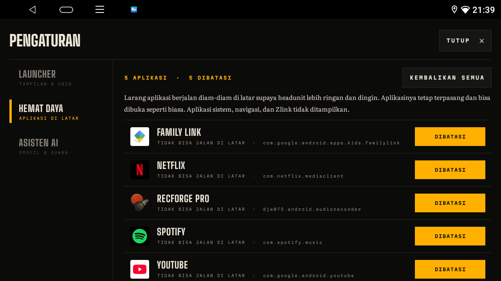

# Cara Pasang & Pakai KlikDash

Panduan untuk pemula. Tidak perlu komputer. Cukup headunit, flashdisk, dan internet (misalnya hotspot HP)
saat pertama kali memasang.

[English](INSTALL.md) | **Bahasa Indonesia**

> ⚠️ **Lakukan saat mobil diam.** Jangan mengoperasikan layar sambil menyetir.

## Yang dibutuhkan

- Headunit Android **10 atau lebih baru** dengan layar **1280×720** (dibuat untuk NWD K2401)
- Flashdisk, atau cara lain untuk memindahkan file ke headunit
- Internet sekali untuk mengunduh teks Al-Qur'an (±6 MB), dan untuk murattal surah yang ingin diputar

## 1. Unduh aplikasinya

Di HP atau laptop, buka **[klikapps.pages.dev](https://klikapps.pages.dev)**, lalu ketuk **Download
KlikDash**. Bisa juga lewat halaman [Releases](https://github.com/ashafizullah/klikdash/releases/latest).
Hasilnya file bernama `klikdash-<versi>.apk`. Salin file itu ke flashdisk.

## 2. Pasang di headunit

1. Colok flashdisk ke port USB headunit.
2. Buka **File Manager** (kadang bernama *File Explorer*), lalu cari file `klikdash-<versi>.apk`.
3. Ketuk file itu, lalu pilih **Install**.
4. Kalau muncul peringatan *"aplikasi dari sumber tidak dikenal"*, ketuk **Setelan**, izinkan File Manager
   memasang aplikasi, lalu kembali dan ketuk **Install** lagi.

## 3. Jadikan tampilan utama

Buka **KlikDash**. Di kiri atas ada tombol kuning **JADIKAN TAMPILAN UTAMA**. Ketuk tombol itu.

- **Headunit NWD:** KlikDash langsung mengatur dirinya sebagai tampilan utama, lalu muncul pesan
  *"KlikDash sekarang tampilan utama"*. Tombol kuningnya pun hilang.
- **Headunit lain:** terbuka halaman **Aplikasi home default**. Pilih **KlikDash**, lalu tekan Kembali.

**Muncul pesan "Belum berhasil. Aktifkan USB debugging"?** Itu artinya opsi pengembang headunit masih mati.
Nyalakan dulu:
1. Buka **Pengaturan › Tentang** (atau *Info perangkat*), lalu ketuk **Nomor build / Versi** 7 kali sampai
   muncul tulisan *"Anda sekarang pengembang"*. Beberapa headunit meminta kode pabrik di sini. Kodenya biasanya
   ada di buku manual atau bisa ditanyakan ke penjual (sering `8888`, `3368`, atau `1234`).
2. Buka **Pengaturan › Opsi pengembang**, lalu nyalakan **USB debugging**.
3. Kembali ke KlikDash dan ketuk lagi tombol kuningnya.

## 4. Izinkan lokasi

Saat diminta, ketuk **Izinkan**. Lokasi dipakai untuk menghitung jadwal sholat sesuai kota Anda. Sebelum GPS
mendapat sinyal, jadwalnya memakai kota perkiraan (misalnya *JAKARTA · PERKIRAAN*). Parkir di tempat
terbuka supaya GPS cepat mendapat sinyal.

## 5. Al-Qur'an

1. Sambungkan headunit ke internet, misalnya lewat hotspot HP.
2. Ketuk ubin **AL-QUR'AN**, lalu ketuk **UNDUH TEKS**. Cukup sekali; setelah itu mushaf bisa dibaca offline.

   

3. Pilih surah, lalu ketuk ayat atau tombol ▶. Murattal Mishary Alafasy diunduh sambil diputar.
4. Ingin bisa diputar tanpa internet di perjalanan? Ketuk **UNDUH** di surah itu sebelum berangkat. Surah
   yang sudah lengkap ditandai **OFFLINE**.

   

Murattal tetap berbunyi saat Anda membuka Maps atau aplikasi lain, dan bisa dijeda atau dilanjutkan dari
notifikasi atau tombol media (termasuk tombol setir, bila headunit meneruskannya ke aplikasi).

## 6. Wajib dicek sebelum berkendara

Dalam keadaan mobil diam, pastikan semua ini masih berfungsi:
- **Kamera mundur:** masukkan gigi R, gambar kamera harus langsung muncul
- **Kamera 360** (jika ada)
- **Peringatan pintu terbuka** dan info mobil
- **Tombol setir:** volume, lagu berikutnya, dan telepon
- **Radio, Bluetooth, dan telepon**

Kalau ada yang tidak jalan, **kembalikan ke launcher bawaan** (lihat di bawah), lalu laporkan lewat
[issue](https://github.com/ashafizullah/klikdash/issues). **Jangan berkendara dengan kamera mundur yang
tidak berfungsi.**

## Pemakaian sehari-hari

- **Buka aplikasi:** ketuk ubinnya.
- **Ganti aplikasi di ubin:** tekan lama ubin, lepas di tempat, lalu pilih aplikasinya.
- **Tukar posisi ubin:** tekan lama ubin, geser ke ubin lain, lalu lepas.
- **Semua aplikasi:** ketuk ubin **SEMUA**. Tekan lama sebuah aplikasi di sana untuk membuka infonya
  (misalnya untuk uninstall).
- **Suhu CPU** di kiri atas berwarna amber mulai 70 °C dan merah ("PANAS") mulai 85 °C.

## Hemat Daya

Headunit terasa panas atau lambat? Sebagian aplikasi, misalnya Netflix atau Spotify, bisa berjalan diam-diam di
latar walaupun tidak dibuka. Untuk membatasinya:

1. Ketuk **SEMUA**, lalu **HEMAT DAYA** di kanan atas.
2. Ketuk **BATASI** di aplikasi yang tidak perlu jalan di latar. Tulisannya berubah menjadi **DIBATASI**.
   Aplikasi yang *SEDANG BERJALAN DI LATAR* tampil paling atas.

Aplikasinya **tidak dihapus** dan tetap bisa dibuka seperti biasa; ia hanya tidak bisa jalan sendiri di
belakang. Ketuk lagi untuk mengizinkan, atau **KEMBALIKAN SEMUA** untuk mengembalikan semuanya. Aplikasi
sistem, Maps, Waze, dan Zlink sengaja tidak ditampilkan supaya navigasi dan CarPlay tetap jalan. Fitur ini butuh
USB debugging aktif, sama seperti tombol tampilan utama.

## Kembali ke launcher bawaan

Ketuk **SEMUA**, lalu ketuk **LAUNCHER BAWAAN** di kanan atas, dan konfirmasi. KlikDash tetap terpasang dan
bisa dijadikan tampilan utama lagi kapan saja.

Mau menghapus KlikDash sepenuhnya? Buka **Pengaturan › Aplikasi › KlikDash › Uninstall**. Audio murattal
yang sudah diunduh ikut terhapus.

## Tanya jawab

**Setelah restart, tampilan lama yang muncul.**
Buka KlikDash dari daftar aplikasi, lalu ketuk lagi tombol kuning **JADIKAN TAMPILAN UTAMA**. Pada headunit
NWD, pengaturan ini tersimpan permanen dan biasanya cukup dilakukan sekali.

**Muncul "AUDIO BELUM ADA · SAMBUNGKAN INTERNET".**
Murattal untuk surah itu belum diunduh. Sambungkan internet, lalu putar lagi atau ketuk **UNDUH**.

**WiFi mati sendiri saat CarPlay atau Android Auto nirkabel tersambung.**
Itu normal. CarPlay nirkabel memakai hotspot headunit, dan headunit tidak bisa menjalankan hotspot dan WiFi
biasa bersamaan. Unduh surah yang ingin diputar sebelum menyambungkan CarPlay.

**Ada ubin yang kosong atau bertulisan "KETUK UNTUK ISI".**
Aplikasi bawaan untuk ubin itu tidak ada di headunit Anda. Ketuk ubin itu, lalu pilih aplikasi lain.

**Suhu CPU tidak tampil.**
Sensor suhu di headunit itu tidak bisa dibaca oleh aplikasi. Fitur lain tetap jalan.

**Tanggal Hijriah beda satu hari dari pengumuman resmi.**
Ketuk tanggal Hijriah di home, lalu pilih koreksi −2 sampai +2 hari.

**Kecepatan tampil "--".**
GPS belum mendapat sinyal, misalnya di basement atau garasi. Angkanya muncul lagi begitu GPS mendapat sinyal.
Kecepatan dari GPS bisa sedikit berbeda dari speedometer mobil; speedometer biasanya menunjukkan sedikit lebih
tinggi.

**Jadwal sholat berbeda sekitar satu menit dari masjid.**
Jadwal dihitung dengan metode Kemenag dan bisa selisih sekitar satu menit. Ikuti masjid atau otoritas
setempat.
