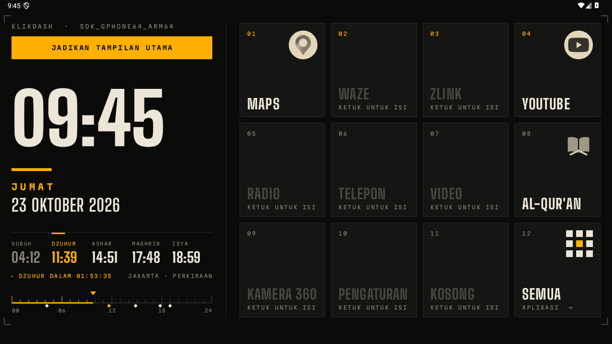
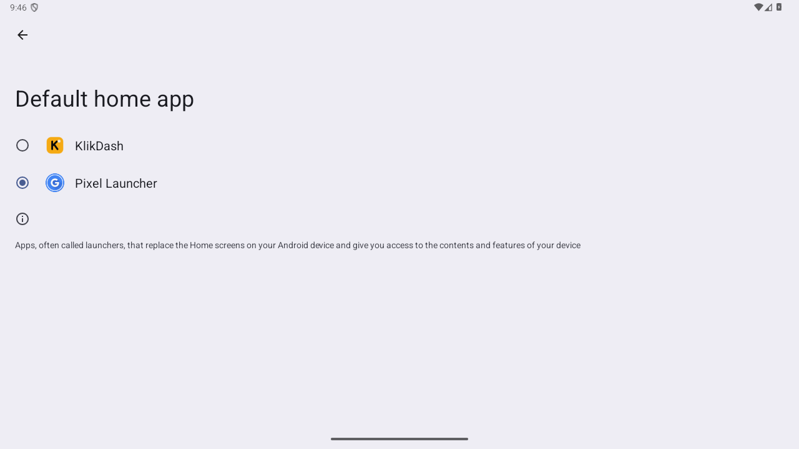
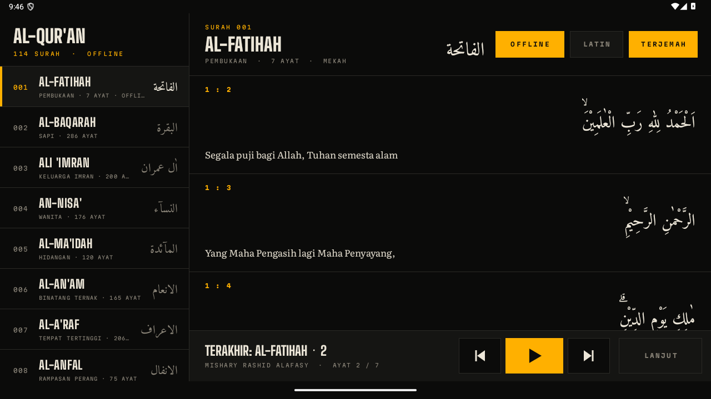
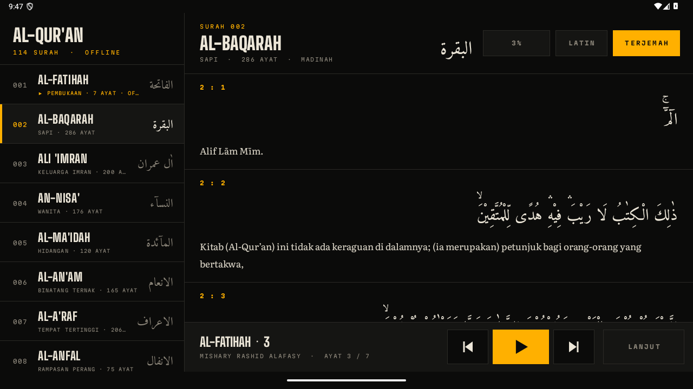
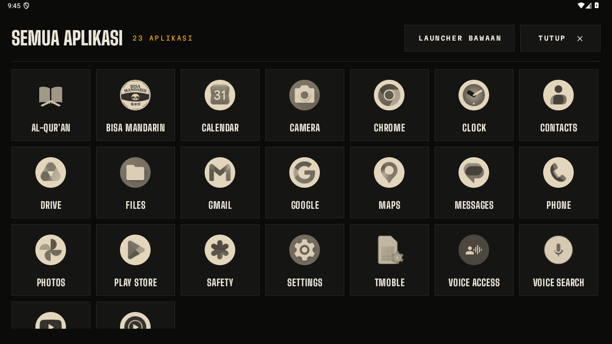

# How to Install & Use KlikDash

A beginner's guide. No computer needed: just the headunit, a USB stick, and internet (for example your
phone's hotspot) during the first setup.

**English** | [Bahasa Indonesia](INSTALL.id.md)

> ⚠️ **Do this with the car parked.** Do not operate the screen while driving.
>
> The app's own interface is in Indonesian; the button names below are shown as they appear on screen.

## What you need

- An Android **10 or newer** headunit with a **1280×720** screen (made for the NWD K2401)
- A USB stick, or another way to copy a file to the headunit
- Internet once, to download the Quran text (~6 MB), and for the recitation of any surah you want to play

## 1. Download the app

On your phone or laptop, open **[klikapps.pages.dev](https://klikapps.pages.dev)** and tap **Download
KlikDash**, or use the [Releases](https://github.com/ashafizullah/klikdash/releases/latest) page. You get a
file called `klikdash-<version>.apk`. Copy it to a USB stick.

## 2. Install it on the headunit

1. Plug the USB stick into the headunit.
2. Open **File Manager** (sometimes called *File Explorer*) and find `klikdash-<version>.apk`.
3. Tap the file and choose **Install**.
4. If you see *"apps from unknown sources"*, tap **Settings**, allow the File Manager to install apps, go
   back and tap **Install** again.

## 3. Make it the home screen

Open **KlikDash**. At the top left there is a yellow **JADIKAN TAMPILAN UTAMA** ("make it the main screen")
button. Tap it.

- **NWD headunits:** KlikDash sets itself as the home screen right away and shows *"KlikDash sekarang
  tampilan utama"* ("KlikDash is now the main screen"). The yellow button then disappears.
- **Other headunits:** the **Default home app** page opens. Pick **KlikDash** and press Back.

**Seeing "Belum berhasil. Aktifkan USB debugging" ("not done yet, turn on USB debugging")?** The headunit's
developer options are off. Turn them on:
1. Open **Settings › About** (or *Device info*) and tap **Build number / Version** 7 times until you see
   *"You are now a developer"*. Some headunits ask for a factory code here. It is usually in the manual or
   available from the seller (often `8888`, `3368` or `1234`).
2. Open **Settings › Developer options** and turn on **USB debugging**.
3. Go back to KlikDash and tap the yellow button again.

## 4. Allow location

Tap **Allow** when asked. Location is used to calculate prayer times for your city. Until the GPS gets a
signal, an estimated city is used (for example *JAKARTA · PERKIRAAN*). Park in the open so the GPS locks on
faster.

## 5. Quran

1. Connect the headunit to the internet, for example through your phone's hotspot.
2. Tap the **AL-QUR'AN** tile, then **UNDUH TEKS** ("download text"). This is needed only once; after that
   the mushaf works offline.

   

3. Pick a surah and tap a verse or the ▶ button. Mishary Alafasy's recitation downloads as it plays.
4. Want to play it offline on the road? Tap **UNDUH** ("download") on that surah before you leave. Complete
   surahs are marked **OFFLINE**.

   

The recitation keeps playing while you use Maps or other apps, and can be paused or resumed from the
notification or media buttons (including steering-wheel buttons, if the headunit passes them to apps).

## 6. Check before you drive

With the car parked, make sure all of these still work:
- **Reverse camera:** shift into R and the camera image must appear right away
- **360° camera** (if fitted)
- **Door-open warnings** and car info
- **Steering-wheel buttons:** volume, next track and phone
- **Radio, Bluetooth and phone calls**

If anything does not work, **switch back to the stock launcher** (see below) and report it in an
[issue](https://github.com/ashafizullah/klikdash/issues). **Do not drive with a reverse camera that is not
working.**

## Everyday use

- **Open an app:** tap its tile.
- **Change a tile's app:** long-press the tile, release in place, then pick an app.
- **Swap two tiles:** long-press a tile, drag it onto another one, and release.
- **All apps:** tap the **SEMUA** tile. Long-press an app there to open its info (for example to uninstall).
- **CPU temperature** at the top left turns amber from 70 °C and red ("PANAS", hot) from 85 °C.

## Switch back to the stock launcher

Tap **SEMUA**, then **LAUNCHER BAWAAN** ("stock launcher") at the top right, and confirm. KlikDash stays
installed and can be made the home screen again at any time.

To remove KlikDash completely, open **Settings › Apps › KlikDash › Uninstall**. Downloaded recitation audio
is deleted with it.

## FAQ

**After a restart, the old screen shows up.**
Open KlikDash from the app list and tap the yellow **JADIKAN TAMPILAN UTAMA** button again. On NWD headunits
the setting is permanent and usually needs to be done only once.

**It says "AUDIO BELUM ADA · SAMBUNGKAN INTERNET" ("no audio yet, connect to the internet").**
That surah's recitation has not been downloaded yet. Connect to the internet and play it again, or tap
**UNDUH**.

**WiFi turns off by itself when wireless CarPlay or Android Auto connects.**
That is normal. Wireless CarPlay uses the headunit's hotspot, and the headunit cannot run a hotspot and normal
WiFi at the same time. Download the surahs you want before connecting CarPlay.

**Some tiles are empty or say "KETUK UNTUK ISI" ("tap to fill").**
The stock app for that tile is not on your headunit. Tap the tile and pick another app.

**The CPU temperature does not show.**
The temperature sensor on that headunit cannot be read by apps. Everything else still works.

**Prayer times differ from the mosque by about a minute.**
They are calculated with the Kemenag method and can differ by about a minute. Follow your local mosque or
authority.
